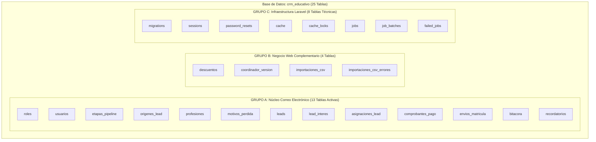

# 🏛️ ESPECIFICACIÓN FÍSICA Y ARQUITECTURA DE LA BASE DE DATOS: `crm_educativo`
### INF513 - Tecnología Web | Grupo 05 SC | Docente: Msc. Ing. Evans Balcázar Veizaga
### Base de Datos Relacional: PostgreSQL 14+ | Codificación: UTF-8

---

## 📌 1. Diagnóstico Integral y Clasificación de Tablas

En la base de datos `crm_educativo` coexisten **25 tablas en total**. Para la defensa y la documentación oficial del PUDS (Diseño Físico de Base de Datos), se dividen analíticamente en **3 grupos claros**:

### 🔹 Grupo A: Tablas Activas del Sistema Vía Email (13 Tablas)
Son las tablas que el servidor demonio Java (`POP3Listener`, `SMTPSender`, `CommandDispatcher` y DAOs) lee, escribe y actualiza en tiempo real mediante sockets TCP:
1. `roles`: Catálogo de perfiles institucionales (Administrador, Coordinador, Vendedor). *(CU1)*
2. `usuarios`: Cuentas del personal, autenticación, control de round-robin y contraseñas. *(CU1, CU3)*
3. `etapas_pipeline`: Los 6 estados comerciales del embudo (Nuevo, En Contacto, etc.). *(CU4, CU8)*
4. `origenes_lead`: Canales de atracción (Facebook, WhatsApp, Web, etc.). *(CU2, CU8)*
5. `profesiones`: Catálogo de ocupaciones de los prospectos. *(CU2)*
6. `motivos_perdida`: Causas tipificadas de desistimiento comercial. *(CU5, CU8)*
7. `leads`: Entidad central del prospecto, datos de contacto, estado comercial y expediente del alumno. *(CU2-CU8)*
8. `lead_interes`: Vínculo N:M con programas o módulos académicos y snapshot del curso. *(CU2)*
9. `asignaciones_lead`: Historial y trazabilidad de traspasos de leads entre vendedores. *(CU3)*
10. `comprobantes_pago`: Registro contable de depósitos bancarios, estados y revisión. *(CU6)*
11. `envios_matricula`: Registro de auditoría y payload JSON de la formalización de matrícula. *(CU6)*
12. `bitacora`: Línea de tiempo cronológica (timeline) de notas, transiciones y eventos. *(CU7)*
13. `recordatorios`: Agenda de compromisos comerciales y alarmas futuras. *(CU7)*

### 🔹 Grupo B: Tablas de Negocio del Sistema Web Complementario (4 Tablas)
Tablas que soportan funcionalidades específicas del panel web Laravel/Inertia, pero que **no son consultadas de forma directa por el protocolo de correos**:
1. `descuentos`: Políticas de descuento arancelario (Beca Pronto Pago, Excelencia, Convenio). El lead tiene una clave foránea `id_descuento` hacia esta tabla.
2. `coordinador_version`: Vinculación N:M entre un usuario Coordinador y versiones específicas de programas para filtrar vistas web.
3. `importaciones_csv`: Registro cabecera de subida masiva de prospectos mediante hojas Excel/CSV desde la interfaz web.
4. `importaciones_csv_errores`: Tabla detalle que almacena filas descartadas durante la importación masiva web.

### 🔹 Grupo C: Tablas Técnicas del Framework Web (8 Tablas)
Tablas autogeneradas por Laravel para soporte HTTP e infraestructura:
* `migrations`, `sessions`, `password_resets`, `cache`, `cache_locks`, `jobs`, `job_batches`, `failed_jobs`.
> **Nota para la defensa:** Estas 8 tablas se omiten del diagrama entidad-relación del negocio porque no modelan entidades del CRM, sino el funcionamiento interno del framework web.

---

## 📐 2. Diccionario Físico Detallado: Grupo A (Núcleo Correo Electrónico)

---

### 1. Tabla: `roles`
* **Descripción:** Catálogo de roles de seguridad para control de acceso basado en roles (RBAC).

| Columna | Tipo de Dato | Nulable | Clave / Default | Descripción / Restricciones |
| :--- | :--- | :---: | :--- | :--- |
| `id_rol` | `bigint` | NO | **PK** / `nextval(...)` | Identificador único del rol. |
| `nombre` | `varchar(30)` | NO | | Nombre institucional: `Administrador`, `Coordinador`, `Vendedor`. |
| `descripcion` | `varchar(150)` | SÍ | `NULL` | Alcance y responsabilidades operativas del rol. |
| `created_at` | `timestamp(0)` | SÍ | `NULL` | Fecha y hora de creación del registro. |
| `updated_at` | `timestamp(0)` | SÍ | `NULL` | Fecha y hora de última modificación. |

---

### 2. Tabla: `usuarios`
* **Descripción:** Registro central de operadores y personal institucional del CRM.

| Columna | Tipo de Dato | Nulable | Clave / Default | Descripción / Restricciones |
| :--- | :--- | :---: | :--- | :--- |
| `id_usuario` | `bigint` | NO | **PK** / `nextval(...)` | Identificador único del personal. |
| `id_rol` | `bigint` | NO | **FK** | Referencia a `roles(id_rol)` ON DELETE CASCADE. |
| `nombre_completo` | `varchar(120)` | NO | | Nombre y apellido oficial del usuario. |
| `correo` | `varchar(120)` | NO | **UNIQUE** | Correo electrónico utilizado para autenticar remitente. |
| `password_hash` | `varchar(255)` | NO | | Hash SHA-256 o Bcrypt de la contraseña. |
| `activo` | `boolean` | NO | `true` | Indica si la cuenta se encuentra habilitada para operar. |
| `participa_round_robin`| `boolean` | NO | `true` | Habilita al vendedor para el reparto automático equitativo. |
| `ultimo_acceso` | `timestamp(0)` | SÍ | `NULL` | Registro de última conexión o actividad. |
| `remember_token` | `varchar(100)` | SÍ | `NULL` | Token de persistencia de sesión. |
| `created_at` | `timestamp(0)` | SÍ | `NULL` | Fecha de creación del registro. |
| `updated_at` | `timestamp(0)` | SÍ | `NULL` | Fecha de actualización del registro. |

---

### 3. Tabla: `etapas_pipeline`
* **Descripción:** Catálogo maestro con las 6 etapas fijas del embudo de ventas comercial.

| Columna | Tipo de Dato | Nulable | Clave / Default | Descripción / Restricciones |
| :--- | :--- | :---: | :--- | :--- |
| `id_etapa` | `bigint` | NO | **PK** / `nextval(...)` | Identificador numérico secuencial (1 al 6). |
| `nombre` | `varchar(30)` | NO | | Nombre de la etapa: `Nuevo`, `En Contacto`, `Seguimiento`, `Promesa de Pago`, `Convertido`, `Perdido`. |
| `orden` | `integer` | NO | | Secuencia numérica del embudo (1, 2, 3, 4, 5, 6). |

---

### 4. Tabla: `origenes_lead`
* **Descripción:** Canales oficiales de captación o prospección institucional.

| Columna | Tipo de Dato | Nulable | Clave / Default | Descripción / Restricciones |
| :--- | :--- | :---: | :--- | :--- |
| `id_origen` | `bigint` | NO | **PK** / `nextval(...)` | Identificador único del canal de captación. |
| `nombre` | `varchar(50)` | NO | | Nombre del canal: `Facebook`, `WhatsApp`, `Web`, `Referido`, etc. |

---

### 5. Tabla: `profesiones`
* **Descripción:** Catálogo de profesiones y áreas de conocimiento de los postulantes.

| Columna | Tipo de Dato | Nulable | Clave / Default | Descripción / Restricciones |
| :--- | :--- | :---: | :--- | :--- |
| `id_profesion` | `bigint` | NO | **PK** / `nextval(...)` | Identificador de la profesión u ocupación. |
| `nombre` | `varchar(100)` | NO | | Nombre de la carrera o área académica. |

---

### 6. Tabla: `motivos_perdida`
* **Descripción:** Catálogo institucional de causas de deserción y pérdida de prospectos.

| Columna | Tipo de Dato | Nulable | Clave / Default | Descripción / Restricciones |
| :--- | :--- | :---: | :--- | :--- |
| `id_motivo` | `bigint` | NO | **PK** / `nextval(...)` | Identificador de la causal de pérdida. |
| `nombre` | `varchar(80)` | NO | | Causa: `Factor económico`, `Horario no disponible`, `Ya no interesado`, `Sin respuesta`. |

---

### 7. Tabla: `leads`
* **Descripción:** Entidad central que modela al prospecto a lo largo de todo su ciclo comercial hasta convertirse en alumno.

| Columna | Tipo de Dato | Nulable | Clave / Default | Descripción / Restricciones |
| :--- | :--- | :---: | :--- | :--- |
| `id_lead` | `bigint` | NO | **PK** / `nextval(...)` | Identificador único del prospecto. |
| `nombre` | `varchar(120)` | NO | | Nombre comercial o de contacto preliminar. |
| `telefono` | `varchar(20)` | NO | | Teléfono boliviano validado (7 a 8 dígitos). |
| `correo` | `varchar(120)` | SÍ | `NULL` | Correo electrónico del prospecto (habilita autoservicio). |
| `id_origen` | `bigint` | NO | **FK** | Referencia a `origenes_lead(id_origen)`. |
| `id_etapa` | `bigint` | NO | **FK** / `'1'::bigint` | Referencia a `etapas_pipeline(id_etapa)`. |
| `id_vendedor` | `bigint` | SÍ | **FK** / `NULL` | Referencia a `usuarios(id_usuario)`. `NULL` representa **Bolsa Común**. |
| `id_motivo_perdida` | `bigint` | SÍ | **FK** / `NULL` | Referencia a `motivos_perdida(id_motivo)`. Obligatorio si etapa es 6 (*Perdido*). |
| `comentario_perdida`| `text` | SÍ | `NULL` | Justificación analítica de la pérdida comercial. |
| `id_importacion` | `bigint` | SÍ | **FK** / `NULL` | Referencia a `importaciones_csv(id_importacion)`. |
| `fecha_asignacion` | `timestamp(0)` | SÍ | `NULL` | Marca temporal de la última asignación a un vendedor. |
| `ci` | `varchar(20)` | SÍ | `NULL` | Cédula de identidad (Exigido en CU6 para matrícula). |
| `nombre_completo` | `varchar(150)` | SÍ | `NULL` | Nombre formal y oficial para el expediente del alumno. |
| `fecha_nacimiento` | `date` | SÍ | `NULL` | Fecha de nacimiento formal del alumno (YYYY-MM-DD). |
| `ciudad` | `varchar(60)` | SÍ | `NULL` | Ciudad de residencia oficial del alumno. |
| `created_by` | `bigint` | NO | **FK** | Usuario que dio de alta el prospecto (`usuarios.id_usuario`). |
| `created_at` | `timestamp(0)` | SÍ | `CURRENT_TIMESTAMP` | Fecha de captación o registro en el CRM. |
| `updated_at` | `timestamp(0)` | SÍ | `NULL` | Fecha de última modificación comercial. |
| `id_profesion` | `bigint` | SÍ | **FK** / `NULL` | Referencia a `profesiones(id_profesion)`. |
| `id_descuento` | `bigint` | SÍ | **FK** / `NULL` | Referencia a `descuentos(id_descuento)`. |

---

### 8. Tabla: `lead_interes`
* **Descripción:** Relación de cursos, programas y diplomados en los que ha manifestado interés un prospecto.

| Columna | Tipo de Dato | Nulable | Clave / Default | Descripción / Restricciones |
| :--- | :--- | :---: | :--- | :--- |
| `id_interes` | `bigint` | NO | **PK** / `nextval(...)` | Identificador único del registro de interés. |
| `id_lead` | `bigint` | NO | **FK** | Referencia a `leads(id_lead)` ON DELETE CASCADE. |
| `tipo` | `varchar(10)` | NO | | Tipo de oferta académica: `'PROGRAMA'` o `'MODULO'`. |
| `id_version_externo`| `bigint` | SÍ | `NULL` | Código externo del programa en el catálogo institucional. |
| `id_modulo_externo` | `bigint` | SÍ | `NULL` | Código externo del módulo en el catálogo institucional. |
| `nombre_snapshot` | `varchar(150)` | NO | | Nombre literal del curso guardado como captura histórica. |

---

### 9. Tabla: `asignaciones_lead`
* **Descripción:** Bitácora histórica inmutable de traspasos y asignaciones de prospectos.

| Columna | Tipo de Dato | Nulable | Clave / Default | Descripción / Restricciones |
| :--- | :--- | :---: | :--- | :--- |
| `id_asignacion` | `bigint` | NO | **PK** / `nextval(...)` | Identificador único de la asignación. |
| `id_lead` | `bigint` | NO | **FK** | Referencia a `leads(id_lead)` ON DELETE CASCADE. |
| `id_vendedor_anterior`| `bigint`| SÍ | **FK** / `NULL` | Ejecutivo anterior (`usuarios.id_usuario`). `NULL` si venía de bolsa común. |
| `id_vendedor_nuevo` | `bigint` | NO | **FK** | Nuevo ejecutivo asignado (`usuarios.id_usuario`). |
| `asignado_por` | `bigint` | NO | **FK** | Administrador que ejecutó la orden (`usuarios.id_usuario`). |
| `tipo` | `varchar(20)` | NO | | Modalidad: `'MANUAL'`, `'ROUND_ROBIN'`, `'TRANSFERENCIA'`. |
| `motivo` | `varchar(200)` | SÍ | `NULL` | Justificación obligatoria en transferencias. |
| `created_at` | `timestamp(0)` | NO | `CURRENT_TIMESTAMP` | Fecha y hora exacta de la asignación. |

---

### 10. Tabla: `comprobantes_pago`
* **Descripción:** Registro contable de depósitos bancarios y transferencias para validación de matrícula.

| Columna | Tipo de Dato | Nulable | Clave / Default | Descripción / Restricciones |
| :--- | :--- | :---: | :--- | :--- |
| `id_comprobante` | `bigint` | NO | **PK** / `nextval(...)` | Identificador único del comprobante. |
| `id_lead` | `bigint` | NO | **FK** | Referencia a `leads(id_lead)` ON DELETE CASCADE. |
| `subido_por` | `bigint` | NO | **FK** | Usuario que registró el depósito (`usuarios.id_usuario`). |
| `archivo_url` | `varchar(255)` | NO | | Identificador o referencia (ej. Banco + Nro. Operación). |
| `tipo_archivo` | `varchar(10)` | NO | `'TRANSF'` | Tipo de documento contable (`TRANSF`, `DEPOSITO`). |
| `monto` | `numeric(10,2)`| SÍ | `NULL` | Monto formal en Bolivianos (Bs.). |
| `estado` | `varchar(15)` | NO | `'PENDIENTE'` | Estados válidos: `'PENDIENTE'`, `'APROBADO'`, `'RECHAZADO'`. |
| `revisado_por` | `bigint` | SÍ | **FK** / `NULL` | Administrador contable que validó (`usuarios.id_usuario`). |
| `fecha_revision` | `timestamp(0)` | SÍ | `NULL` | Fecha y hora de la aprobación o rechazo. |
| `comentario_rechazo`| `text` | SÍ | `NULL` | Motivo de rechazo en caso de inconsistencia contable. |
| `created_at` | `timestamp(0)` | SÍ | `CURRENT_TIMESTAMP` | Fecha de registro del comprobante. |
| `updated_at` | `timestamp(0)` | SÍ | `NULL` | Fecha de actualización de estado. |

---

### 11. Tabla: `envios_matricula`
* **Descripción:** Registro de formalización de matrícula e integración externa.

| Columna | Tipo de Dato | Nulable | Clave / Default | Descripción / Restricciones |
| :--- | :--- | :---: | :--- | :--- |
| `id_envio` | `bigint` | NO | **PK** / `nextval(...)` | Identificador único de la matrícula. |
| `id_lead` | `bigint` | NO | **FK** | Referencia a `leads(id_lead)` ON DELETE CASCADE. |
| `id_comprobante` | `bigint` | SÍ | **FK** / `NULL` | Comprobante aprobado que respaldó la inscripción. |
| `payload` | `jsonb` | SÍ | `NULL` | Resumen estructurado JSON con datos del alumno y curso. |
| `estado` | `varchar(15)` | NO | `'PENDIENTE'` | Estado de la matrícula (`MATRICULADO`, `PENDIENTE`). |
| `respuesta_api` | `text` | SÍ | `NULL` | Respuesta o código oficial de registro académico. |
| `intentos` | `integer` | NO | `0` | Contador de intentos de despacho. |
| `created_at` | `timestamp(0)` | SÍ | `CURRENT_TIMESTAMP` | Fecha de emisión de matrícula. |
| `updated_at` | `timestamp(0)` | SÍ | `NULL` | Fecha de actualización. |

---

### 12. Tabla: `bitacora`
* **Descripción:** Línea de tiempo cronológica (*timeline*) de interacciones, notas y eventos de auditoría por lead.

| Columna | Tipo de Dato | Nulable | Clave / Default | Descripción / Restricciones |
| :--- | :--- | :---: | :--- | :--- |
| `id_evento` | `bigint` | NO | **PK** / `nextval(...)` | Identificador único del evento en la bitácora. |
| `id_lead` | `bigint` | NO | **FK** | Referencia a `leads(id_lead)` ON DELETE CASCADE. |
| `id_usuario` | `bigint` | SÍ | **FK** / `NULL` | Personal autor del evento (`usuarios.id_usuario`). |
| `tipo` | `varchar(20)` | NO | | Clasificador: `'CREACION'`, `'ASIGNACION'`, `'CAMBIO_ESTADO'`, `'NOTA'`, `'PAGO'`, `'MATRICULA'`, `'RECORDATORIO'`. |
| `descripcion` | `text` | NO | | Contenido de la nota o detalle explícito del evento. |
| `id_etapa_anterior`| `bigint` | SÍ | **FK** / `NULL` | Etapa previa en caso de transición (`etapas_pipeline`). |
| `id_etapa_nueva` | `bigint` | SÍ | **FK** / `NULL` | Nueva etapa alcanzada en la transición (`etapas_pipeline`). |
| `created_at` | `timestamp(0)` | NO | `CURRENT_TIMESTAMP` | Marca temporal exacta de registro. |

---

### 13. Tabla: `recordatorios`
* **Descripción:** Agenda de compromisos comerciales y alertas futuras para la fuerza de ventas.

| Columna | Tipo de Dato | Nulable | Clave / Default | Descripción / Restricciones |
| :--- | :--- | :---: | :--- | :--- |
| `id_recordatorio`| `bigint` | NO | **PK** / `nextval(...)` | Identificador único de la tarea programada. |
| `id_lead` | `bigint` | NO | **FK** | Referencia a `leads(id_lead)` ON DELETE CASCADE. |
| `id_usuario` | `bigint` | NO | **FK** | Ejecutivo asignado a cumplir la tarea (`usuarios.id_usuario`). |
| `fecha_hora` | `timestamp(0)` | NO | | Fecha y hora límite programada para la acción. |
| `descripcion` | `varchar(255)` | NO | | Descripción de la tarea (ej. llamada, envío de temario). |
| `estado` | `varchar(15)` | NO | `'PENDIENTE'` | Estado: `'PENDIENTE'`, `'COMPLETADO'`, `'CANCELADO'`. |
| `created_at` | `timestamp(0)` | SÍ | `CURRENT_TIMESTAMP` | Fecha de creación del recordatorio. |
| `updated_at` | `timestamp(0)` | SÍ | `NULL` | Fecha de cierre o modificación. |

---

## 🌐 3. Diccionario Físico: Grupo B (Tablas de Negocio Sistema Web)

---

### 14. Tabla: `descuentos`
* **Descripción:** Políticas institucionales de descuento para matriculación temprana o convenios.
* **Columnas:**
  * `id_descuento` (`bigint`, PK, NOT NULL)
  * `nombre` (`varchar(100)`, NOT NULL)
  * `porcentaje` (`numeric(5,2)`, NOT NULL)
  * `descripcion` (`varchar(255)`, NULL)
  * `activo` (`boolean`, NOT NULL, default `true`)

### 15. Tabla: `coordinador_version`
* **Descripción:** Tabla pivote N:M entre un usuario Coordinador y versiones de programas.
* **Columnas:**
  * `id_usuario` (`bigint`, NOT NULL, FK `usuarios(id_usuario)` ON DELETE CASCADE)
  * `id_version_externo` (`bigint`, NOT NULL)
  * **PK Compuesta:** `(id_usuario, id_version_externo)`

### 16. Tabla: `importaciones_csv`
* **Descripción:** Cabecera de auditoría de importación masiva de leads vía archivo CSV en la web.
* **Columnas:**
  * `id_importacion` (`bigint`, PK, NOT NULL)
  * `id_usuario` (`bigint`, NOT NULL, FK `usuarios(id_usuario)` ON DELETE CASCADE)
  * `nombre_archivo` (`varchar(150)`, NOT NULL)
  * `total_filas` (`integer`, NULL)
  * `filas_exitosas` (`integer`, NULL)
  * `filas_fallidas` (`integer`, NULL)
  * `created_at` (`timestamp(0)`, NOT NULL, default `CURRENT_TIMESTAMP`)

### 17. Tabla: `importaciones_csv_errores`
* **Descripción:** Filas que fallaron en la importación masiva web con el motivo de error.
* **Columnas:**
  * `id_error` (`bigint`, PK, NOT NULL)
  * `id_importacion` (`bigint`, NOT NULL, FK `importaciones_csv(id_importacion)` ON DELETE CASCADE)
  * `numero_linea` (`integer`, NOT NULL)
  * `motivo` (`text`, NOT NULL)

---

## ⚙️ 4. Diccionario Físico: Grupo C (Infraestructura Web Laravel)

Para que el equipo cuente con el registro exhaustivo de las 25 tablas físicas:
* `migrations`: `id` (serial PK), `migration` (varchar 255), `batch` (int). Control de versiones de la BD.
* `sessions`: `id` (varchar 255 PK), `user_id` (bigint nullable), `ip_address` (varchar 45), `user_agent` (text), `payload` (text), `last_activity` (int).
* `password_resets`: `id_reset` (bigint PK), `id_usuario` (bigint FK usuarios), `token_hash` (varchar 255), `expira_en` (timestamp), `usado` (bool).
* `cache`: `key` (varchar 255 PK), `value` (text), `expiration` (bigint).
* `cache_locks`: `key` (varchar 255 PK), `owner` (varchar 255), `expiration` (bigint).
* `jobs`: `id` (bigint PK), `queue` (varchar 255), `payload` (text), `attempts` (smallint), `reserved_at` (int), `available_at` (int), `created_at` (int).
* `job_batches`: `id` (varchar 255 PK), `name` (varchar 255), `total_jobs` (int), `pending_jobs` (int), `failed_jobs` (int), `failed_job_ids` (text), `options` (text), `cancelled_at` (int), `created_at` (int), `finished_at` (int).
* `failed_jobs`: `id` (bigint PK), `uuid` (varchar 255 unique), `connection` (varchar 255), `queue` (varchar 255), `payload` (text), `exception` (text), `failed_at` (timestamp).
