# ⏱️ GUÍA RÁPIDA DE DEFENSA EN 15 MINUTOS (GUION OFICIAL)
### INF513 - Tecnología Web | Grupo 05 SC | Docente: Msc. Ing. Evans Balcázar Veizaga
### Sistema Transaccional por Correo Electrónico – CRM Educativo UNEXO

---

## 🎯 1. Estrategia Maestra para la Mesa de Examen (Sin Fallas ni Fricción)

> [!IMPORTANT]
> **La Clave del Éxito con el Ing. Evans Balcázar:**
> 1. **El docente evalúa enviando correos reales desde su propio Gmail o celular.**
> 2. **Paso 0:** Le pedimos que mande `HELP[]`. Con eso capturamos su dirección exacta en los logs de consola de Java (`S : From: <correo_del_docente>`).
> 3. **Paso 1 (Estratégico):** Inmediatamente, desde el correo de la Administradora (`nataly.vane.mm@gmail.com`), le creamos una cuenta de **Administrador**:
>    `CREARUSUARIO["Ing. Evans Balcazar", "<correo_del_docente>", "12345678", "Administrador"]`
> 4. **Ventaja Total:** Al tener rol `Administrador`, **el docente podrá ejecutar los 10 pasos seguidos** (registrar leads, ver catálogos, asignar vendedores, avanzar etapas, registrar comprobantes, aprobar pagos y matricular) **sin ningún error de permisos ni bloqueos de seguridad**. El flujo corre limpio, rápido y en menos de 10 minutos.

---

## ⏰ 2. Cronograma de Tiempo (Mesa de 15 a 20 Minutos)

| Tiempo | Fase | Objetivo | Responsable |
| :---: | :--- | :--- | :---: |
| **Min 0 - 2** | **Base de Datos** | Mostrar tablas en terminal PostgreSQL (`psql -d crm_educativo`, `\dt`). | Todo el equipo |
| **Min 2 - 4** | **Pitch Ejecutivo (2 min)** | Explicar qué es UNEXO (Postgrados y Capacitación), arquitectura Socket puro (POP3/SMTP) y automatización del embudo comercial. | Nataly |
| **Min 4 - 13** | **Demostración en Vivo** | Ejecución de la cadena de 10 comandos en vivo con el correo del docente. | Docente / Equipo |
| **Min 13 - 15** | **Verificación Final y Cierre** | Ver el prospecto en Etapa 5 (`LEADSETAPA[5]`) y responder preguntas técnicas de bajo nivel. | Todo el equipo |

---

## 📋 3. Cadena de Comandos Oficial: De Prospecto a Alumno Matriculado

A continuación se detalla la secuencia exacta. Tener esta tabla abierta en pantalla o impresa durante la defensa:

```mermaid
flowchart LR
    A["Paso 0: HELP[]"] --> B["Paso 1: CREARUSUARIO (Admin)"]
    B --> C["Paso 2: REGISTRARPROSPECTO"]
    C --> D["Paso 3: VINCULARINTERES"]
    D --> E["Paso 4: ASIGNARMANUAL"]
    E --> F["Paso 5: MOVERETAPA (4)"]
    F --> G["Paso 6: REGISTRARCOMPROBANTE"]
    G --> H["Paso 7: APROBARPAGO"]
    H --> I["Paso 8: COMPLETARDATOSALUMNO"]
    I --> J["Paso 9: CONVERTIRAMATRICULA"]
    J --> K["Paso 10: LEADSETAPA[5]"]
```



---

### PASO 0: Docente envía `HELP[]` (Captura de Correo)
* **¿Quién lo envía?:** El Ingeniero Evans Balcázar desde su correo personal.
* **Asunto del Correo:**
  ```text
  HELP[]
  ```
* **Qué decirle al Ingeniero:**  
  *«Ingeniero, por favor envíe un correo a grupo05sc@tecnoweb.org.bo con el asunto HELP[] para que el servidor le responda con el catálogo general de comandos interactivos.»*
* **Qué pasa en pantalla / logs:**  
  El demonio Java imprime:  
  `S : From: evansbv@gmail.com` *(o el correo que use el docente)*.  
  El docente recibe en segundos una tabla formal con los 42 comandos institucionales clasificados por Casos de Uso.

---

### PASO 1: Nataly da de alta al Ingeniero como Administrador
* **¿Quién lo envía?:** Nataly desde `nataly.vane.mm@gmail.com`.
* **Asunto del Correo:**
  ```text
  CREARUSUARIO["Ing. Evans Balcazar", "evansbv@gmail.com", "12345678", "Administrador"]
  ```
  *(Reemplazar `evansbv@gmail.com` por el correo real que capturamos en el Paso 0).*
* **Qué decirle al Ingeniero:**  
  *«Ingeniero, ya le hemos creado su cuenta oficial con privilegios de Administrador. Si desea verificarlo, puede enviar `QUIENSOY[]` y verá su ficha activa con sus credenciales.»*
* **Respuesta que recibe Nataly y verificación:**  
  `[EXITO] Usuario Creado Exitosamente: Ing. Evans Balcazar (Administrador).`

---

### PASO 2: El Docente registra un nuevo prospecto
* **¿Quién lo envía?:** El Docente desde su cuenta de correo.
* **Asunto del Correo:**
  ```text
  REGISTRARPROSPECTO["Carlos Villagomez", "70012345", "carlos.v@gmail.com", "Facebook", "Ingeniería de Sistemas / Software"]
  ```
* **Qué decirle al Ingeniero:**  
  *«Ingeniero, ahora registre a un nuevo interesado en postgrado. Los parámetros son: Nombre, Teléfono, Correo, Origen de captación y Profesión.»*
* **Tip de Respaldo (Si pregunta qué orígenes existen):**  
  *«Puede consultar los canales válidos enviando `LISTARORIGENES[]`. Los admitidos son Facebook, Google Ads, Sitio Web, Referido, TikTok o WhatsApp.»*
* **Respuesta que recibe el Docente:**  
  `[EXITO] Captación de Prospecto: Carlos Villagomez registrado satisfactoriamente con ID #15. Estado: Bolsa Común (Pendiente de Vendedor).`  
  *(Anotar el ID del lead generado, por ejemplo `#15`)*.

---

### PASO 3: El Docente vincula el interés académico al prospecto
* **¿Quién lo envía?:** El Docente.
* **Tip previo (Si el docente no sabe qué oferta hay):**  
  *«Ingeniero, si desea ver nuestros diplomados y maestrías disponibles, envíe `LISTAROFERTA[]` y le listará la oferta oficial con códigos y aranceles.»*
* **Asunto del Correo:**
  ```text
  VINCULARINTERES["15", "PROGRAMA", "101", "Diplomado en Ciberseguridad Defensiva"]
  ```
  *(Reemplazar `15` por el ID del prospecto creado en el Paso 2).*
* **Respuesta que recibe el Docente:**  
  `[EXITO] Interés Académico Vinculado: Programa PROG-101 (Diplomado en Ciberseguridad Defensiva) asociado al prospecto #15.`

---

### PASO 4: El Docente asigna el prospecto a un Vendedor
* **¿Quién lo envía?:** El Docente.
* **Tip previo (Si el docente no sabe qué vendedores existen):**  
  *«Ingeniero, puede enviar `LISTARUSUARIOS[]` para ver a todo nuestro equipo comercial disponible.»*  
  *(Allí verá a Vanessa Martínez con ID #3 y a Nicol Flores con ID #4 con rol Vendedor)*.
* **Asunto del Correo:**
  ```text
  ASIGNARMANUAL["15", "3"]
  ```
  *(Asigna el lead #15 al vendedor #3: Vanessa Martínez)*.
* **Respuesta que recibe el Docente:**  
  `[EXITO] Asignación Manual Exitosa: El prospecto #15 ha sido asignado a la cartera comercial de Vanessa Martínez con registro en auditoría.`

---

### PASO 5: El Docente avanza el lead a Promesa de Pago (Etapa 4)
* **¿Quién lo envía?:** El Docente.
* **Asunto del Correo:**
  ```text
  MOVERETAPA["15", "4"]
  ```
* **Qué decirle al Ingeniero:**  
  *«Ingeniero, el vendedor ya contactó al prospecto y este acordó realizar la transferencia bancaria hoy mismo. Por tanto, muévalo a la Etapa 4 (Promesa de Pago).»*
* **Tip de Respaldo (Si pregunta qué etapas existen):**  
  *«Las 6 etapas estándar del embudo comercial son: 1. Nuevo, 2. En Contacto, 3. Seguimiento, 4. Promesa de Pago, 5. Convertido, 6. Perdido.»*
* **Respuesta que recibe el Docente:**  
  `[EXITO] Etapa Comercial Actualizada: El prospecto #15 avanzó a 'Promesa de Pago'. Hito documentado en bitácora.`

---

### PASO 6: El Docente registra el Comprobante Bancario
* **¿Quién lo envía?:** El Docente.
* **Asunto del Correo:**
  ```text
  REGISTRARCOMPROBANTE["15", "Banco Mercantil Santa Cruz", "TR-998877", "2500.00"]
  ```
* **Qué decirle al Ingeniero:**  
  *«El prospecto envió su comprobante de pago por 2,500 Bs. Registre el comprobante con: ID Lead, Banco emisor, Número de transacción y Monto abonado.»*
* **Respuesta que recibe el Docente:**  
  `[EXITO] Comprobante de Pago Registrado: Comprobante #1 ingresado a la cola de verificación contable en estado PENDIENTE.`  
  *(Anotar el ID del comprobante generado, por ejemplo `#1`)*.

---

### PASO 7: El Docente aprueba el Pago Bancario
* **¿Quién lo envía?:** El Docente (con su rol Administrador).
* **Asunto del Correo:**
  ```text
  APROBARPAGO["1"]
  ```
  *(Reemplazar `1` por el ID del comprobante obtenido en el Paso 6).*
* **Qué decirle al Ingeniero:**  
  *«Como Administrador, usted valida que los fondos ingresaron efectivamente a la cuenta institucional y aprueba el pago para habilitar la matrícula.»*
* **Respuesta que recibe el Docente:**  
  `[EXITO] Pago Aprobado Satisfactoriamente: Comprobante #1 validado con éxito. El prospecto queda habilitado para formalizar matrícula.`

---

### PASO 8: El Docente completa los datos del Alumno (Expediente)
* **¿Quién lo envía?:** El Docente.
* **Asunto del Correo:**
  ```text
  COMPLETARDATOSALUMNO["15", "8921043 SC", "1998-05-14", "Santa Cruz de la Sierra"]
  ```
* **Qué decirle al Ingeniero:**  
  *«Para emitir el título o constancia formal, completamos los datos reglamentarios: Cédula de Identidad, Fecha de Nacimiento (YYYY-MM-DD) y Ciudad de Residencia.»*
* **Respuesta que recibe el Docente:**  
  `[EXITO] Datos Académicos Registrados: Expediente del prospecto #15 actualizado con todos los requisitos formales.`

---

### PASO 9: El Docente formaliza la Matrícula Regular
* **¿Quién lo envía?:** El Docente.
* **Asunto del Correo:**
  ```text
  CONVERTIRAMATRICULA["15"]
  ```
* **Qué decirle al Ingeniero:**  
  *«Ahora ejecutamos el cierre institucional. El sistema valida automáticamente que el pago esté aprobado y el expediente completo, crea el registro de matrícula y avanza el prospecto a Etapa 5 (Convertido).»*
* **Respuesta que recibe el Docente:**  
  El docente recibe un diploma/credencial institucional formal con:
  * Título: **Constancia Oficial de Matrícula Académica**
  * Código Oficial: `MATR-2026-15`
  * Nombre: `Carlos Villagomez`
  * Cédula: `8921043 SC`
  * Etapa Final: Badge verde `[Convertido]`
  * Autorizado por: `Ing. Evans Balcazar (Administrador)`

---

### PASO 10: Verificación Final en el Embudo Comercial
* **¿Quién lo envía?:** El Docente.
* **Asunto del Correo:**
  ```text
  LEADSETAPA["5"]
  ```
  *(O también con comillas: `LEADSETAPA["5"]`)*.
* **Qué decirle al Ingeniero:**  
  *«Ingeniero, para verificar la columna final de cierre de ventas, consulte los alumnos matriculados con LEADSETAPA[5].»*
* **Respuesta que recibe el Docente:**  
  Tabla formal de la **Columna Kanban: Convertido** donde figura claramente **Carlos Villagomez** con su correo, teléfono y vendedor asignado.

---

## 🛡️ 4. Preguntas Típicas del Docente y Respuestas Inmediatas

### Pregunta 1: *«¿Y qué pasa si el prospecto decide no inscribirse o cancela?»*
* **Respuesta Inmediata:**  
  *«Ingeniero, tenemos implementado el CU5 de Motivos de Pérdida. Primero puede enviar `LISTARMOTIVOSPERDIDA[]` para ver las causales (Presupuesto, Falta de Tiempo, Prefirió Otra Institución, etc.) y luego ejecutar:»*
  ```text
  MARCARPERDIDO["15", "1", "El cliente indica que se quedó sin presupuesto este semestre"]
  ```
  *«El sistema mueve el lead a la Etapa 6 (Perdido), registra la causa y exige una justificación obligatoria en bitácora para análisis gerencial.»*

### Pregunta 2: *«¿Y cómo ve el Administrador las estadísticas globales de ventas?»*
* **Respuesta Inmediata:**  
  *«Enviamos cualquiera de los comandos del CU8:»*
  * `REPORTEEMBUDO[]` *(Distribución porcentual de prospectos en las 6 etapas)*
  * `REPORTECONVERSION[]` *(Tasa de éxito comercial y ventas por ejecutivo)*
  * `REPORTEORIGENES[]` *(Efectividad de Facebook vs Google Ads vs TikTok)*
  * `REPORTEMOTIVOSPERDIDA[]` *(Principales razones de fuga de clientes)*

### Pregunta 3: *«¿Cómo manejan la asignación equitativa entre vendedores?»*
* **Respuesta Inmediata:**  
  *«Mediante el algoritmo rotativo Round-Robin:»*
  ```text
  EJECUTARROUNDROBIN[]
  ```
  *«Toma a los prospectos de la Bolsa Común y los distribuye equitativamente entre los vendedores activos con `recibe_round_robin = true`, actualizando el índice rotativo en memoria y registrando el traspaso en auditoría.»*

### Pregunta 4: *«¿Qué pasa si la base de datos se apaga y vuelve a levantarse?»*
* **Respuesta Inmediata:**  
  *«Nuestro pool dinámico en `DatabaseConnection.java` verifica el estado en cada petición. Si la base cae, el sistema captura la excepción, avisa educadamente al usuario por correo que el servicio está en mantenimiento temporal y, en cuanto PostgreSQL se levanta de nuevo, el sistema se reconecta automáticamente sin necesidad de reiniciar el proceso Java.»*

---

## 💻 5. Verificación en Terminal PostgreSQL durante la Defensa

Si el Ingeniero pide ver las tablas directamente en la consola de Linux:

```bash
# Entrar a PostgreSQL
psql -U postgres -d crm_educativo

# Ver todas las tablas (debe mostrar las 25 tablas físicas)
\dt

# Ver el lead registrado en Etapa 5
SELECT id_lead, nombre, correo, id_etapa, id_vendedor FROM leads WHERE correo = 'carlos.v@gmail.com';

# Ver el comprobante aprobado
SELECT id_comprobante, id_lead, banco, nro_transaccion, monto, estado FROM comprobantes_pago;

# Ver la matrícula formal emitida
SELECT id_matricula, codigo_matricula, id_lead, id_programa, fecha_matricula FROM matriculas;

# Salir de psql
\q
```

---

## 🚀 6. Comando para Iniciar el Servidor de Correos el Día de la Defensa

```bash
cd /home/nataly/Projects/TECNO/crm_correo/INF513_P1

# Compilar todo el proyecto
javac -encoding UTF-8 -cp "lib/postgresql.jar:." -d bin $(find src/main/java -name "*.java")

# Levantar el Demonio de Correos (POP3 puerto 110 + SMTP puerto 25)
java -cp "lib/postgresql.jar:bin" com.tecnoweb.grupo05sc.Main
```
